# Antes y después del trabajo de accesibilidad (web-cliente)

Capturas **reales** de la app del comensal, con los mismos datos de prueba (un restaurante inventado, "Lupulus Casa Matriz", y una mesa de prueba), a 390 px de ancho, como en un celular.

- **Antes** es la app como estaba al empezar el trabajo de accesibilidad: el commit `92904e0` (13/11/2026), antes de la etapa 1.
- **Ahora** es la app con las etapas 1 a 8 de [`../plan-cliente.md`](../plan-cliente.md) (27/11/2026).
- La API está simulada y las capturas son de un servidor de desarrollo: no hay datos de ningún restaurante real.

**Lo que se ve distinto es poco, a propósito:** el coral queda un poco más profundo, los grises (y el texto de ejemplo de los campos) un poco más oscuros, los precios se escriben como en Argentina ("$ 3.200" en lugar de "$3200.00"), los estados de "Mis pedidos" dicen cada uno lo suyo, y hay un anillo de foco cuando se navega con teclado. **Casi todo lo demás no se ve en una captura:** los nombres de los botones, qué lee el lector de pantalla, a dónde va el foco, qué se anuncia. Eso está en [`../bitacora.md`](../bitacora.md).

| Pantalla | Comparación |
| --- | --- |
| Discovery (inicio) | 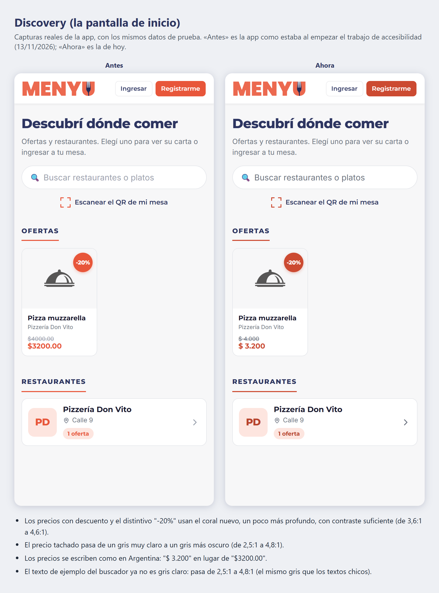 |
| Menú de la mesa | 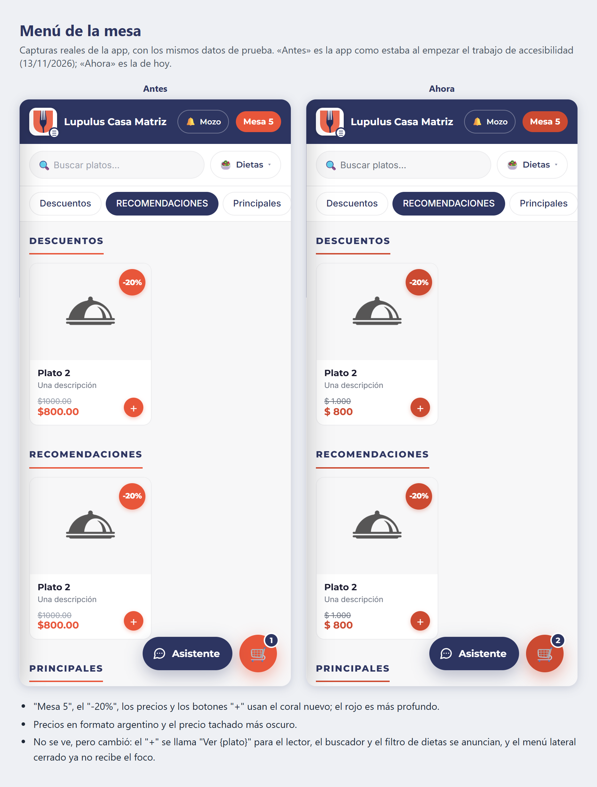 |
| Detalle de un plato | 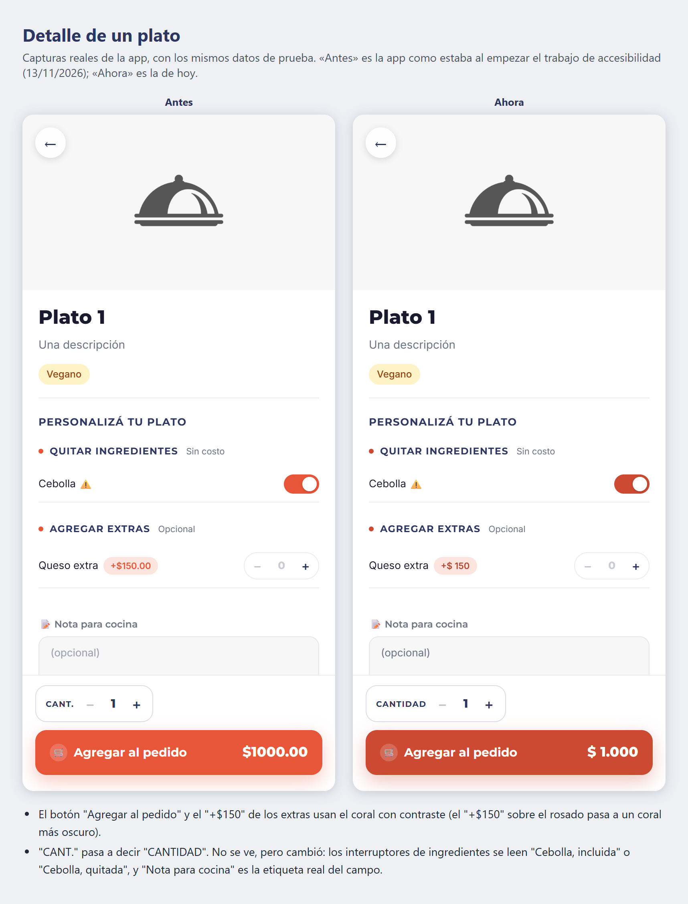 |
| Carrito | 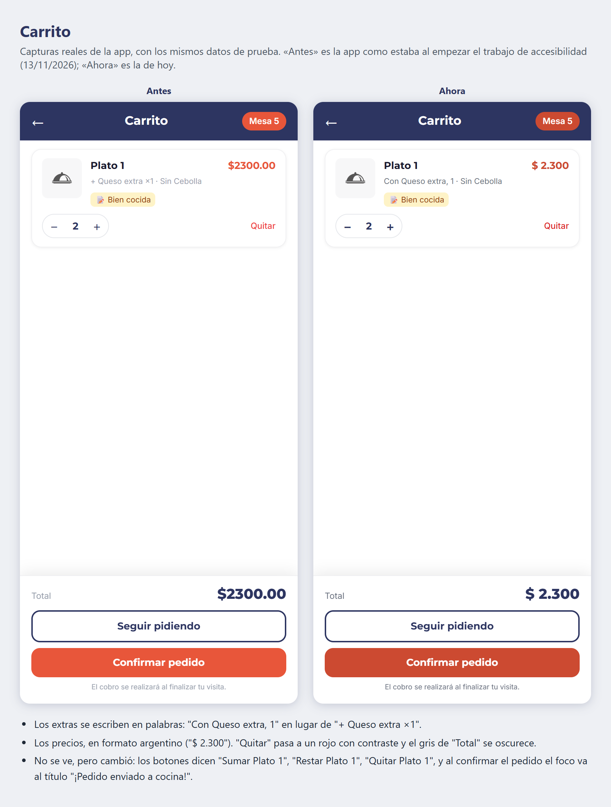 |
| Mis pedidos | 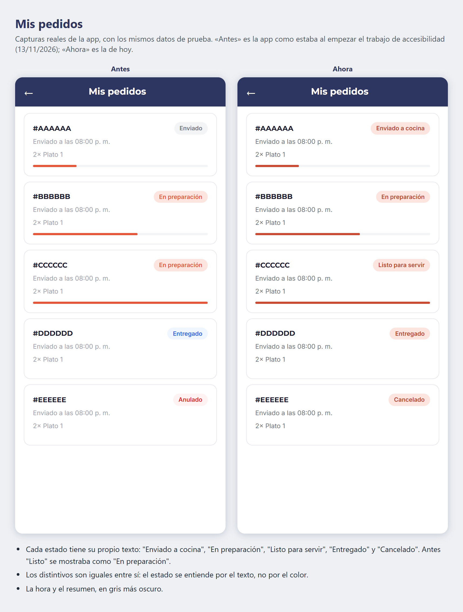 |
| Pagar la cuenta | 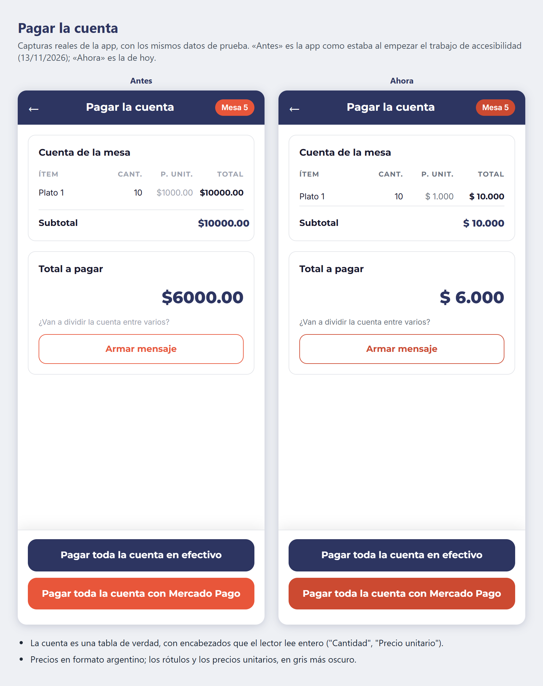 |
| Ingreso a una mesa | 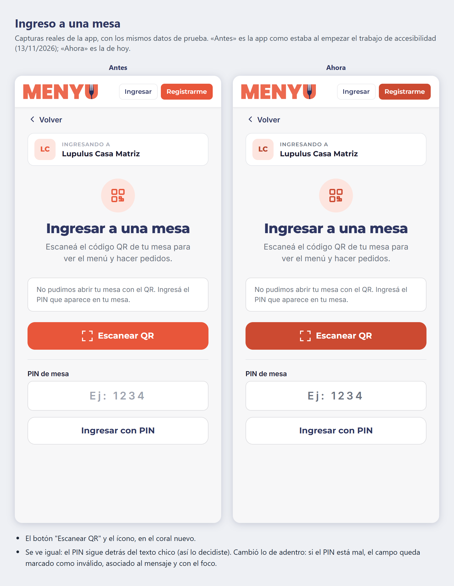 |
| Elegir nombre | 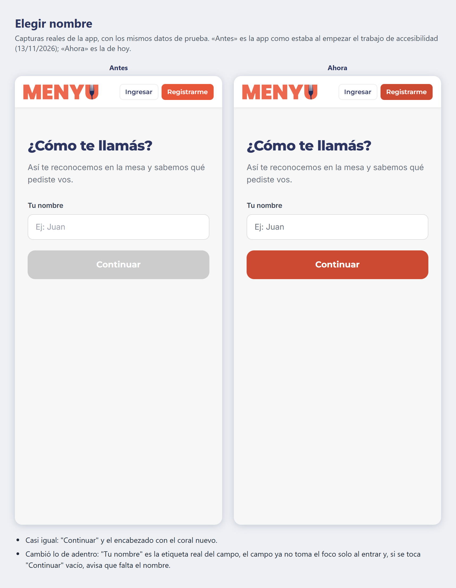 |
| Asistente de la carta | 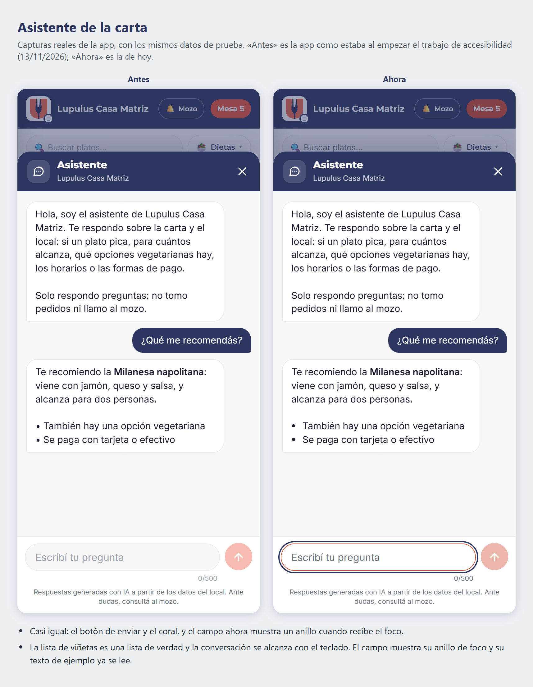 |
| Foco visible con el teclado | 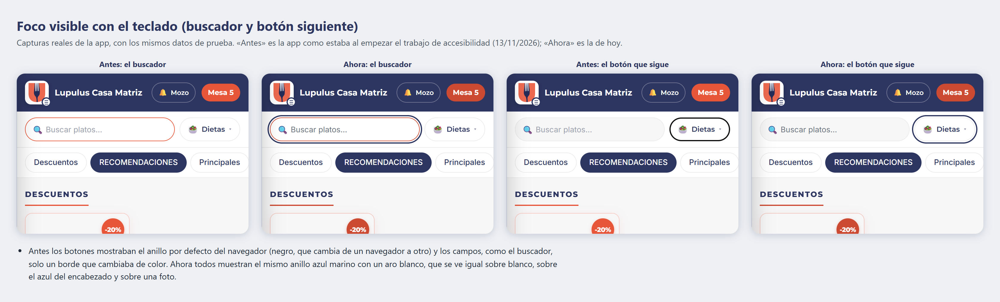 |

## El texto de ejemplo de los campos (decidido el 27/11/2026)

El texto de ejemplo (el *placeholder*: "Buscar platos...", "Ej: Juan", "Escribí tu pregunta") era un gris muy claro de fábrica (`#9CA3AF`, 2,5:1; WCAG pide 4,5:1). **Margarita decidió oscurecerlo** y ahora es el gris de los textos chicos de la app (`#6B7280`, 4,8:1), con una sola regla en `index.css` para todos los campos. Las capturas de arriba ya lo muestran; esta compara los campos de cerca:

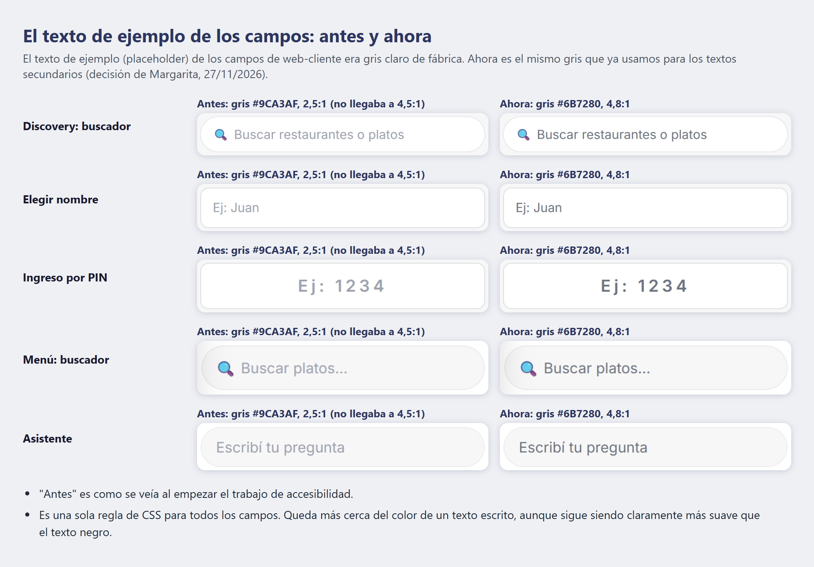

## Lo del asistente que no se ve en una captura

Lo más importante del asistente es lo que oye quien usa un lector de pantalla, y eso no sale en una imagen:

- **Antes**, la respuesta se escribía dentro de una región que anuncia cada cambio: en una respuesta de 3 segundos hubo **22** cambios que un lector podía leer en pedazos, repetidos o cortados. **Ahora** se oye "El asistente está respondiendo…" y, al terminar, la respuesta entera **una sola vez** (2 anuncios).
- Cada burbuja dice quién habla ("Vos preguntaste:", "El asistente respondió:"), las viñetas son una lista, y el foco no se pierde al tocar una sugerencia o "Reintentar".
- Esc cierra el chat desde donde esté el foco, y mientras está abierto la carta de atrás queda inerte.
- Lo único nuevo que se ve: un botón **"Cerrar"** en la hoja "Abriendo el asistente…" (la que aparece unos instantes con conexión lenta) y el anillo de foco de la conversación cuando se llega a ella con el teclado.

El detalle de cada arreglo, con su prueba, está en "Qué se arregló" al final de la cuarta parte de [`../auditoria-general.md`](../auditoria-general.md).
